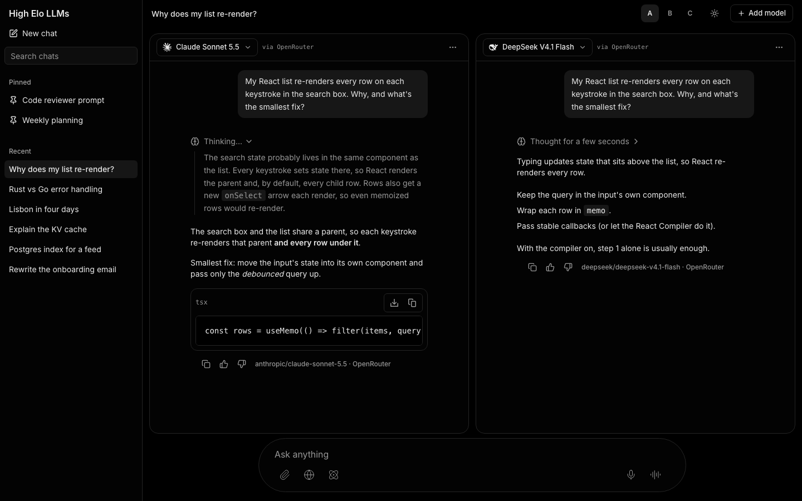
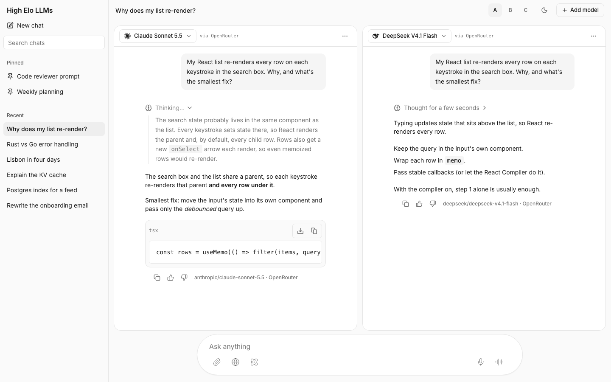
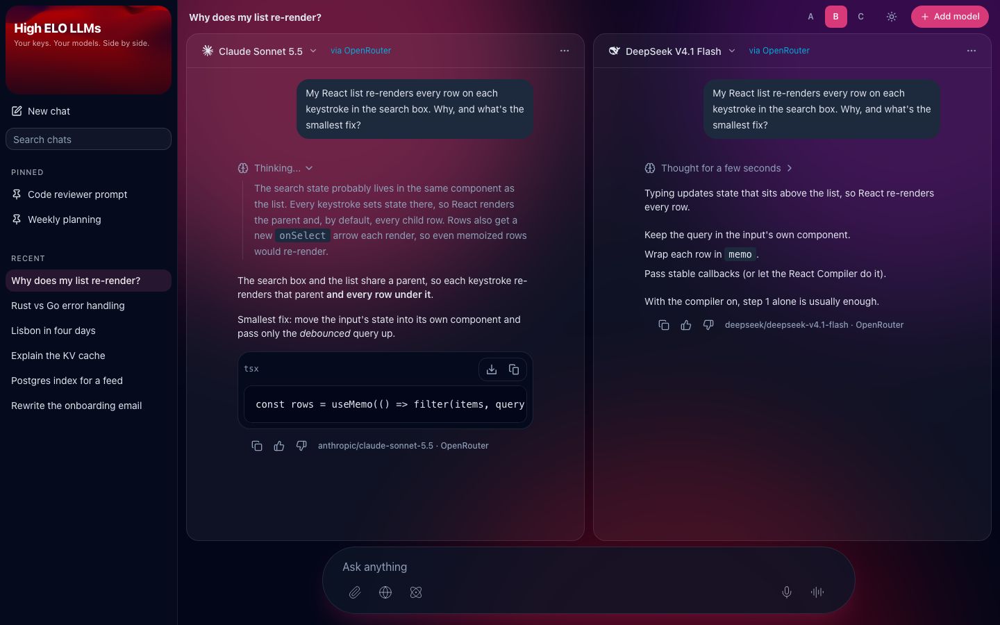
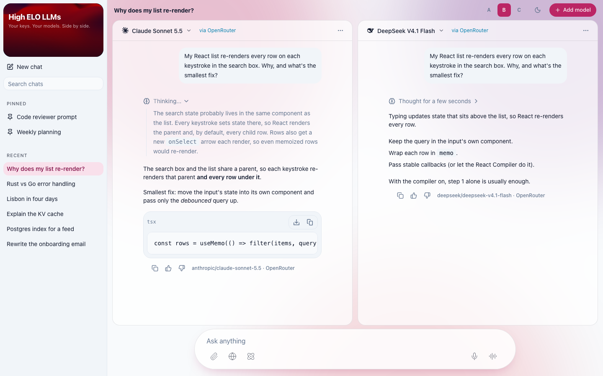
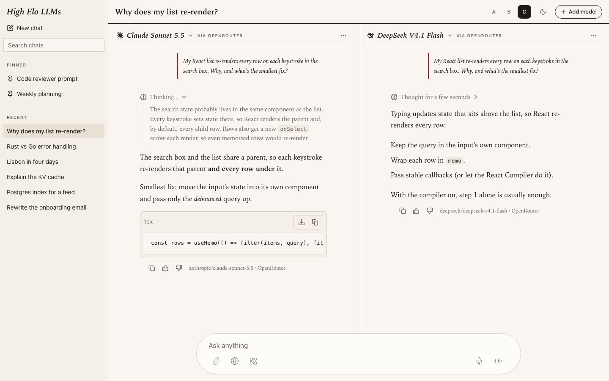
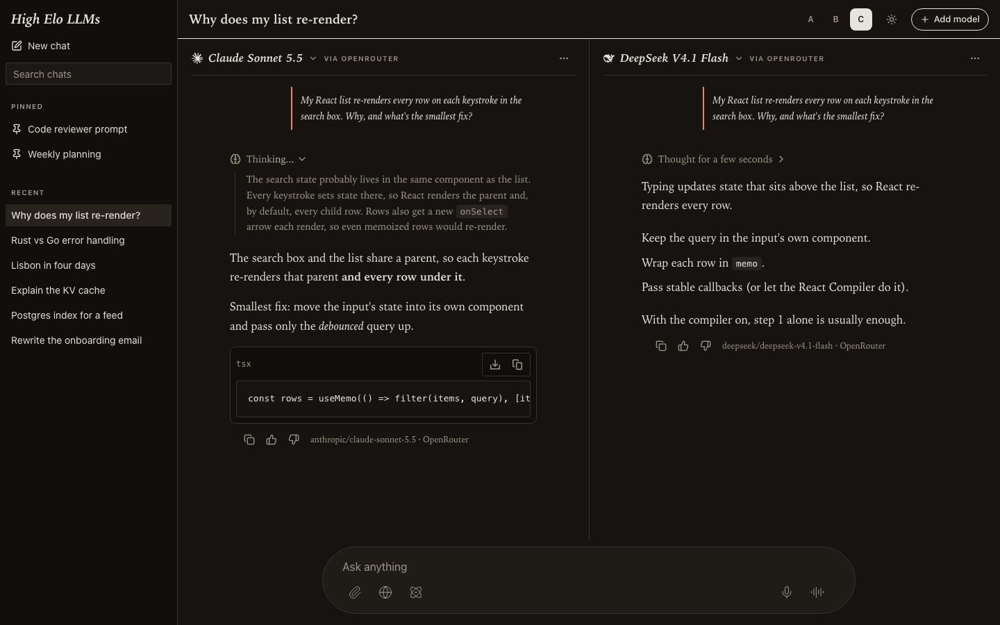

# Design directions (roadmap 3.0)

Three throwaway looks for the app, to pick from before the multi-pane layout (3.1) is built. Each one renders
the same screen from fixture data: the sidebar with chats, two panes side by side (model picker trigger and
"via OpenRouter"), a reply still streaming its reasoning next to a finished one, and the real composer with its
animations.

**See them live:** `bun run dev`, then open `/e2e/design/minimal`, `/e2e/design/brand` or
`/e2e/design/editorial` (`/e2e/design` lists them). The A/B/C buttons switch directions, the sun/moon button
switches mode, and `?theme=light|dark` picks one directly. The pages only exist in dev and `VITE_E2E` builds.

**How they're built:** `src/routes/e2e/design/`. One shared shell (`-shared/design-shell.tsx`) uses the real
sidebar primitives, message list, reasoning trace and composer; each direction is only a stylesheet
(`-shared/<id>.css`) that overrides the shadcn tokens under `[data-design="<id>"]`. No production component or
global token changed. The composer hard-codes black text, so `-shared/base.css` restyles it from outside; the
follow-up slice should move those colors onto tokens inside the composer.

**Reduced motion (hard rule 3):** all three fade the panes in with Motion, which the root `MotionConfig` turns
into a fade with no movement. B's background glow stops (`animation: none`, checked with Playwright's
`reducedMotion: "reduce"`), and its shader card draws one still frame (the landing page's `Scene` already does
this).

## A. Minimal dark

| | Light | Dark (default) |
|---|---|---|
| Background | `oklch(0.985 0 0)` | black `oklch(0 0 0)` |
| Panes | white cards, 1px line, radius 1rem | `oklch(0.1 0 0)` cards, 1px line, radius 1rem |
| Sidebar | `oklch(0.985 0 0)` | `oklch(0.1 0 0)` |
| Text / muted | `oklch(0.205 0 0)` / `oklch(0.556 0 0)` | `oklch(0.94 0 0)` / `oklch(0.68 0 0)` |
| Lines | `oklch(0.922 0 0)` | `oklch(0.26 0 0)` |
| Accent | none: near-black / near-white | |

Type: Geist if installed, else Inter / the system sans; model ids and "via OpenRouter" in the system mono.
Radius 0.5rem.

*Updated after the pick:* the panes are now rounded cards (B's shape, without its glass blur or glow) on a
background a step darker than the cards. The screenshots show this version.

Feels like a tool. Zero hue, flat surfaces, bordered model triggers and mono labels, so
the models' answers are the only thing with weight on the screen. It's the closest to the Vercel AI SDK
playground and will scale cleanly to four narrow panes. The cost is identity: nothing here says "High Elo LLMs",
and next to the landing page's magenta shader it reads like a different product.

## B. Brand

| | Light | Dark (default) |
|---|---|---|
| Background | slate-50 `oklch(0.984 0.003 248)` | slate-950 `oklch(0.129 0.042 265)` |
| Panes | white glass, 72% | white glass, 6%, 16px blur |
| Primary | magenta `#BD285E` (`oklch(0.53 0.19 1)`) | `oklch(0.6 0.2 1)` |
| Accents | violet `#600F75`, cyan `oklch(0.55 0.13 229)` | violet, cyan `oklch(0.7 0.1375 229)` (the landing's link color) |
| Glow | magenta, violet, red blobs at 28% | same at 55%, drifting over 24s |

Type: system sans; extra-bold tight wordmark on the shader card, bold chat title, tracked caps for sidebar
group labels. Radius 0.875rem, pill buttons.

Feels like the landing page kept going. The shader moves into a card at the top of the sidebar, the panes are
frosted glass like the sign-in form, and a slow magenta glow sits behind them. It's the most memorable and the
most "portfolio piece", and dark mode carries it well. Light mode is weaker (pink haze on slate). The risks are
practical: backdrop blur on up to four resizable panes, a WebGL canvas and a glow all cost frames on low-end
laptops, and the glow tints the reply text behind it, which hurts long reads.

## C. Editorial

| | Light (default) | Dark |
|---|---|---|
| Background | paper `oklch(0.975 0.008 85)` | warm charcoal `oklch(0.19 0.009 60)` |
| Sidebar | `oklch(0.955 0.011 82)` | `oklch(0.165 0.008 60)` |
| Text / muted | ink `oklch(0.22 0.012 60)` / `oklch(0.5 0.018 60)` | `oklch(0.92 0.012 85)` / `oklch(0.68 0.02 75)` |
| Accent | oxblood `oklch(0.45 0.14 25)` | terracotta `oklch(0.72 0.12 42)` |

Type: replies, titles and model names in a serif (Iowan Old Style, Charter, Georgia); model names italic like
column bylines; UI labels in small tracked caps in the system sans; code stays mono. Radius 0.25rem.

Feels like reading a magazine that happens to compare models. The question becomes a pull quote with an
oxblood rule, panes are columns divided by rules, and the serif makes long answers comfortable to read side by
side. It's the most distinctive of the three and the calmest. It's also the furthest from both the landing page
and the usual "AI tool" look, the serif gets cramped at four narrow panes, and it has no motion personality of
its own beyond the composer.

## Decision (2026-10-28)

**Yash picked A, with B's rounded pane cards.** Minimal and neutral, dark by default. The look should be
built entirely on tokens (colors, fonts, text sizes, radii), because appearance settings (roadmap 3.11) will
let people change fonts, text size and the colors of everything.

## Recommendation (before the pick)

**A's structure with B's brand on top.** Build the panes the way A does (hairline dividers, flat surfaces, no
glass), dark by default, and take from B: magenta as the one accent (primary buttons, the active chat, focus
rings), the slate-tinted dark background, cyan for provider links, and the shader card at the top of
the sidebar so the app and the landing page feel like one product. Drop B's glass panes and the glow behind the
replies: they're what costs frames and legibility once there are four panes. Keep C's serif in your pocket as an
optional "reading" font setting later rather than the default.

Any mix works; the tokens are per direction, so the follow-up slice can lift a palette from one and the layout
from another.
